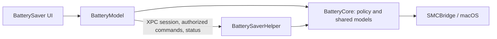

# Battery Saver

Native macOS menu bar app for battery monitoring and charge limits. Its privileged
helper follows the app: Quit restores charging and sleep settings; reopening
reapplies saved preferences. Calibration/discharge cancel on Quit.

## Build and run

### development.sh

Requires **macOS 12+, Swift 5.7+, macOS SDK, Python 3**. No third-party packages.
Tested on a 13-inch M1 MacBook Pro (2020).

Install [Apple Command Line Tools](https://developer.apple.com/documentation/xcode/installing-the-command-line-tools)
if missing; older systems can use compatible tools from [Apple Downloads](https://developer.apple.com/download/all/).

```sh
xcode-select --install
xcrun swift --version
python3 --version
/bin/zsh Scripts/development.sh
```

Builds Debug, runs critical tests, signs/packages `dist/Battery Saver.app`, and
restarts it for manual validation. Reuses `.build/`.

### helper.sh

After building, choose one action (also available through the app):

```sh
sudo /bin/zsh Scripts/helper.sh install
sudo /bin/zsh Scripts/helper.sh update
sudo /bin/zsh Scripts/helper.sh uninstall
```

- **install:** fresh installation, protection off.
- **update:** preserve/migrate settings; roll back on failure; block incompatible downgrades.
- **uninstall:** restore macOS control and remove the helper.

Helper installation/updates require administrator approval. Startup, Quit, and
Discharge on/off need no password; settings changes still require authorization.
Discharge cancels on connection loss, a stalled app session, sleep, or errors.
launchd restarts a failed helper to retry recovery; normal Quit still stops it.
Downloaded apps include `Contents/Resources/helper.sh ACTION` (run with `sudo /bin/zsh`).

### release.sh

```sh
/bin/zsh Scripts/release.sh
```

Builds Release, runs all Swift tests plus live read-only sensor and helper-operation
checks, then packages `dist/Battery Saver.app`. Does not launch it. Run as a normal
user on the target Mac. Signing is ad hoc, without notarization.

## Uninstall

Turn off **Start at login**, then use **Helper → gear → Restore and remove**
(administrator approval required). Quit and delete `Battery Saver.app`.
From a checkout, the equivalent helper removal is:

```sh
sudo /bin/zsh Scripts/helper.sh uninstall
```

## Supporting files

| File | Purpose / usage |
| --- | --- |
| `Scripts/lib/build.sh` | Shared preparation, packaging, signing; sourced by both build scripts. |
| `Scripts/critical-tests.txt` | Development test selection; one `TestClass/testMethod` per line. |
| `Scripts/verify_readings.py` | Release sensor checks; `python3 Scripts/verify_readings.py .build/release/battery-saver-helper`. |
| `Scripts/verify_update_helper.py` | Release installation/migration/rollback fixtures; same invocation with this script. |
| `Scripts/generate_icon.swift` | Regenerate icon: `swift -module-cache-path .build/module-cache Scripts/generate_icon.swift`. |
| `Resources/Helper/{install,update,uninstall}.sh` | Bundled operations; invoke through `helper.sh`. |
| `Resources/Info.plist` | App metadata. |
| `Resources/AppIcon.icns` | Generated app icon. |
| `Resources/org.batterysaver.helper.plist` | On-demand service with failure recovery; applied by install/update. |

## Architecture



`AppDelegate` owns windows; `BatteryModel` owns state and action availability.
`AppPalette` defines app-wide colors; shared controls/styles define appearance.
The helper owns hardware and recovery; closing the last app connection stops it.

## Critical points

Charging control uses undocumented firmware interfaces. Gate readback cannot
prove physical charging; hardware and sleep behavior need manual acceptance.
Avoid concurrent charging controllers. Quit keeps the installation/preferences;
uninstall before deleting the app. See [NOTICE.md](NOTICE.md),
[AGENTS.md](AGENTS.md), and [EASTER_EGGS.md](EASTER_EGGS.md).
