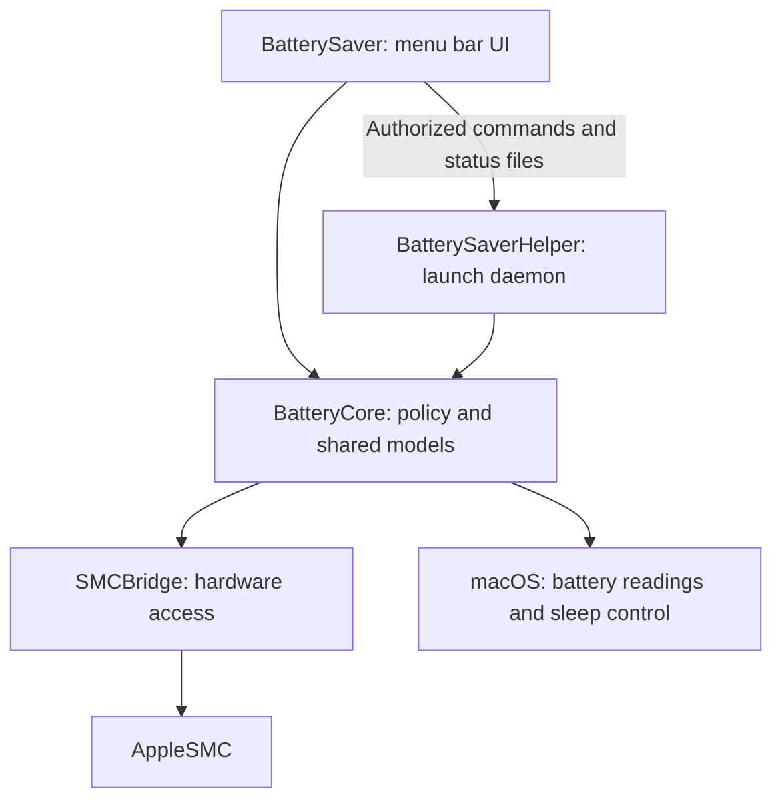

# Battery Saver

Native macOS menu bar app for battery monitoring and charge management. A separate
privileged helper maintains charging policy when the app is closed.

## Build and Run

### development.sh

Requires: macOS 12+, Swift 5.7+, the macOS SDK, and Python 3.

Tested on: M1 MacBook Pro (13-inch, M1, 2020).

No third-party packages are required.

Install [Apple Command Line Tools](https://developer.apple.com/documentation/xcode/installing-the-command-line-tools), if missing, then check the toolchain:

```sh
xcode-select --install
xcrun swift --version
python3 --version
```

For older macOS, use compatible tools from [Apple Downloads](https://developer.apple.com/download/all/).
Development baseline: Xcode 14.2 / Swift 5.7.2 on macOS 12.

From the project directory:

```sh
/bin/zsh Scripts/development.sh
```

Builds Debug, runs critical tests, packages `dist/Battery Saver.app`, and restarts
the UI for manual validation. Reuses `.build/` for fast incremental builds.

### helper.sh

Choose one action after building the app:

```sh
sudo /bin/zsh Scripts/helper.sh install
sudo /bin/zsh Scripts/helper.sh update
sudo /bin/zsh Scripts/helper.sh uninstall
```

`install` creates a fresh installation with protection off. `update` preserves
settings, migrates supported schemas, and rolls back on failure. `uninstall`
restores normal charging and removes the service. Each command takes one action.

The app uses the same dispatcher for authorized helper management and offers an
update when required. Incompatible downgrades are blocked. Downloaded apps
include the dispatcher at `Contents/Resources/helper.sh`; it works without the
source checkout, for example:

```sh
sudo /bin/zsh "/path/to/Battery Saver.app/Contents/Resources/helper.sh" update
```

### release.sh

```sh
/bin/zsh Scripts/release.sh
```

Builds Release, runs all Swift tests, verifies live read-only battery readings,
and checks bundled helper operations with fixtures. Packages into
`dist/Battery Saver.app` only after checks pass; does not launch it. Run as a
normal user on the target Mac. Packages use ad-hoc signing, without Developer ID
signing or notarization.

## Supporting files

| File                                                                                                                              | Purpose and usage                                                                                                                                                |
| --------------------------------------------------------------------------------------------------------------------------------- | ---------------------------------------------------------------------------------------------------------------------------------------------------------------- |
| [critical-tests.txt](Scripts/critical-tests.txt)                                                                                  | Development test selection: one `TestClass/testMethod` per line. Edit when risks change.                                                                         |
| [verify\_readings.py](Scripts/verify_readings.py)                                                                                 | Read-only battery and permission checks; called by Release, or `python3 Scripts/verify_readings.py .build/release/battery-saver-helper`.                         |
| [verify\_update\_helper.py](Scripts/verify_update_helper.py)                                                                      | Dispatcher, installation, migration, and rollback fixtures; called by Release, or `python3 Scripts/verify_update_helper.py .build/release/battery-saver-helper`. |
| [generate\_icon.swift](Scripts/generate_icon.swift)                                                                               | Regenerate the app icon: `swift -module-cache-path .build/module-cache Scripts/generate_icon.swift`, then rebuild.                                               |
| [install.sh](Resources/Helper/install.sh), [update.sh](Resources/Helper/update.sh), [uninstall.sh](Resources/Helper/uninstall.sh) | Bundled operations used through [helper.sh](Scripts/helper.sh).                                                                                                  |
| [Info.plist](Resources/Info.plist)                                                                                                | App metadata; edit, then rebuild.                                                                                                                                |
| [AppIcon.icns](Resources/AppIcon.icns)                                                                                            | App icon generated by `generate_icon.swift`.                                                                                                                     |
| [LaunchDaemon plist](Resources/local.paolo.battery-saver.plist)                                                                   | Background service configuration, applied by the installer.                                                                                                      |

## Architecture

`BatteryModel.batteryTone` selects the state; `AppPalette.swift` maps it to one
shared accent for the menu bar, status window, buttons, sliders, and toggles.
Edit the palette to change colors app-wide. Warning/error colors remain semantic;
the palette also owns theme surfaces and foreground contrast.



## Critical points

Charging control uses undocumented firmware interfaces; gate readback does not
prove physical charging behavior. Hardware and sleep behavior require manual
acceptance. Avoid concurrent charging controllers. Quitting or deleting the app
does not remove its helper; use the app or `helper.sh uninstall` first.
See [NOTICE.md](NOTICE.md) for protocol references and [ETIQUETTE.md](ETIQUETTE.md)
for workspace rules.
